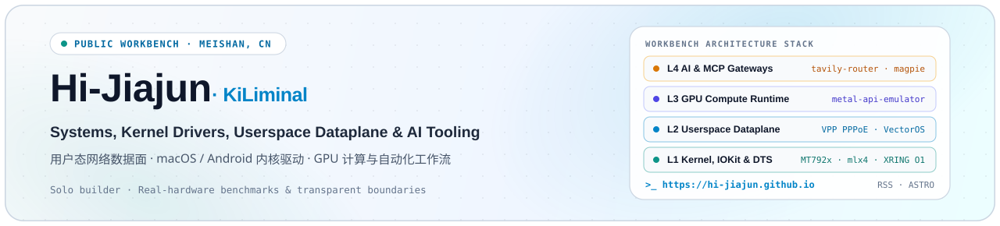

<!-- AUTO-GENERATED FROM README.template.md AND profile-data.yml. DO NOT EDIT DIRECTLY. -->

<picture>
  <source media="(prefers-color-scheme: dark)" srcset="./assets/profile-banner.svg" />
  
</picture>

  <a href="https://hi-jiajun.github.io"><picture><source media="(prefers-color-scheme: dark)" srcset="https://img.shields.io/badge/Blog-hi--jiajun.github.io-0369A1?labelColor=0D1B2A&style=flat&logo=astro&logoColor=38BDF8" /></picture></a>
  <a href="https://space.bilibili.com/474179427"><picture><source media="(prefers-color-scheme: dark)" srcset="https://img.shields.io/badge/Bilibili-KiLiminal-BE185D?labelColor=0D1B2A&style=flat&logo=bilibili&logoColor=F9A8D4" /></picture></a>
  <a href="https://hi-jiajun.github.io/rss.xml"><picture><source media="(prefers-color-scheme: dark)" srcset="https://img.shields.io/badge/RSS-feed-0F766E?labelColor=0D1B2A&style=flat&logo=rss&logoColor=2DD4BF" /></picture></a>
  <a href="mailto:3138947285@qq.com"><picture><source media="(prefers-color-scheme: dark)" srcset="https://img.shields.io/badge/Email-3138947285%40qq.com-1E293B?labelColor=0D1B2A&style=flat&logo=maildotru&logoColor=38BDF8" /></picture></a>

  🛠️ 把 GitHub 与个人博客当作公开工作台：维护从零编写、并在真机或真实流媒体/网络环境下验证的工程项目——每个仓库都写清「已实测通过」与「尚未验证」的边界。 
  GitHub & my blog as a public workbench: systems projects built from scratch and verified on real hardware, documenting clearly what is measured vs. open.

## 🔭 代表项目 Featured Workbench

#### 🌐 网络数据面与路由 Dataplane & Networking

  <a href="https://github.com/Hi-Jiajun/vpp-pppoeclient"><picture><source media="(prefers-color-scheme: dark)" srcset="./assets/generated/cards/vpp-pppoeclient-dark.svg?v=52fca023fe10" /></picture></a>
  <a href="https://github.com/Hi-Jiajun/VectorOS"><picture><source media="(prefers-color-scheme: dark)" srcset="./assets/generated/cards/VectorOS-dark.svg?v=84680e0cbf72" /></picture></a>

#### 🍎 内核驱动与硬件适配 Kernel Drivers & Bring-up

  <a href="https://github.com/Hi-Jiajun/AirportMtk-macOS"><picture><source media="(prefers-color-scheme: dark)" srcset="./assets/generated/cards/AirportMtk-macOS-dark.svg?v=c2681a876675" /></picture></a>
  <a href="https://github.com/Hi-Jiajun/ConnectX3-macOS"><picture><source media="(prefers-color-scheme: dark)" srcset="./assets/generated/cards/ConnectX3-macOS-dark.svg?v=7fe6fb042d10" /></picture></a>

#### 📱 移动 SoC 与无线边界 Mobile SoC & Wireless Lab

  <a href="https://github.com/Hi-Jiajun/dijun-kernel-devicetree"><picture><source media="(prefers-color-scheme: dark)" srcset="./assets/generated/cards/dijun-kernel-devicetree-dark.svg?v=def13e25f100" /></picture></a>
  <a href="https://github.com/Hi-Jiajun/mt6639-wifi7-dijun"><picture><source media="(prefers-color-scheme: dark)" srcset="./assets/generated/cards/mt6639-wifi7-dijun-dark.svg?v=7912996fe53c" /></picture></a>

#### 🧪 GPU 计算与 AI 网关 GPU Compute & AI Tooling

  <a href="https://github.com/Hi-Jiajun/metal-api-emulator"><picture><source media="(prefers-color-scheme: dark)" srcset="./assets/generated/cards/metal-api-emulator-dark.svg?v=18daaca9f9ac" /></picture></a>
  <a href="https://github.com/Hi-Jiajun/tavily-router"><picture><source media="(prefers-color-scheme: dark)" srcset="./assets/generated/cards/tavily-router-dark.svg?v=48b1ad8fe3fc" /></picture></a>

<b>更多开源与实验仓库 · More experiments (4)</b>

- [`MT7922-Bluetooth-macOS`](https://github.com/Hi-Jiajun/MT7922-Bluetooth-macOS) (C++) — MT7922 / RZ616 macOS 蓝牙固件注入驱动与免 Xcode 构建链
- [`AMD-Ryzen-9700X-macOS`](https://github.com/Hi-Jiajun/AMD-Ryzen-9700X-macOS) (C) — Ryzen 7 9700X (Zen 5) + B850 运行 macOS 15/26 实测适配笔记
- [`magpie-agent-varin`](https://github.com/Hi-Jiajun/magpie-agent-varin) (JavaScript, ⭐ 1) — Magpie Agents 扩展工具
- [`nbmachina`](https://github.com/Hi-Jiajun/nbmachina) (JavaScript) — Minecraft 音符盒机器谱面编译器 + Fabric 无损音频 mod

## 📊 研发遥测 Telemetry

  <picture><source media="(prefers-color-scheme: dark)" srcset="./assets/generated/stats/overview-dark.svg?v=496f3dd1d4ef" /></picture>
  <picture><source media="(prefers-color-scheme: dark)" srcset="./assets/generated/stats/languages-dark.svg?v=bb36b153458d" /></picture>

## ✍️ 最新文章 Latest Writing

- `2026-11-18` `AI` **[把公开工作台搬进博客：为什么重做这个站点](https://hi-jiajun.github.io/posts/workbench-and-new-blog/)** — 放弃旧的 Hugo + PaperMod + CMS 模板，用 Astro 与纯 Markdown 重建一个写起来毫无摩擦的个人技术博客，并与 GitHub 个人主页自动联动。
- `2026-11-17` `AI` **[小米 15S Pro (XRING O1) 内核设备树与外部模块 KMI/CRC 契约梳理](https://hi-jiajun.github.io/posts/xring-o1-dijun-kernel-abi-notes/)** — 记录 dijun-kernel-devicetree 仓库的设计脉络：四套严格分层的 DTS 基线、增量 .dtso 补丁，以及锁定 6.18.32-4k VERMAGIC 与 mo…
- `2026-11-10` `AI` **[近期系统与数据面实验盘点：从 VPP 用户态 PPPoE 到驱动移植](https://hi-jiajun.github.io/posts/systems-workbench-overview/)** — 梳理近期几个主线仓库的真实推进状态与边界：vpp-pppoeclient、AirportMtk-macOS、ConnectX3-macOS、metal-api-emulator 与…

→ [进入博客浏览全部文章、项目矩阵与站内搜索 (hi-jiajun.github.io)](https://hi-jiajun.github.io)

## 🧰 技术与支持 Stack &amp; Sponsor

  <picture><source media="(prefers-color-scheme: dark)" srcset="https://img.shields.io/badge/C-VPP%20%26%20kernel-0D1B2A?labelColor=0D1B2A&style=flat&logo=c&logoColor=38BDF8" /></picture>
  <picture><source media="(prefers-color-scheme: dark)" srcset="https://img.shields.io/badge/C%2B%2B-IOKit%20kexts-0D1B2A?labelColor=0D1B2A&style=flat&logo=cplusplus&logoColor=818CF8" /></picture>
  <picture><source media="(prefers-color-scheme: dark)" srcset="https://img.shields.io/badge/Rust-Metal%20/%20systems-0D1B2A?labelColor=0D1B2A&style=flat&logo=rust&logoColor=F59E0B" /></picture>
  <picture><source media="(prefers-color-scheme: dark)" srcset="https://img.shields.io/badge/Python-ABI%20%26%20tooling-0D1B2A?labelColor=0D1B2A&style=flat&logo=python&logoColor=38BDF8" /></picture>
  <picture><source media="(prefers-color-scheme: dark)" srcset="https://img.shields.io/badge/TypeScript-web%20%26%20scripts-0D1B2A?labelColor=0D1B2A&style=flat&logo=typescript&logoColor=38BDF8" /></picture>
  <picture><source media="(prefers-color-scheme: dark)" srcset="https://img.shields.io/badge/Linux%20Kernel-DTS%20%26%20KMI%20gates-0D1B2A?labelColor=0D1B2A&style=flat&logo=linux&logoColor=2DD4BF" /></picture>
  <picture><source media="(prefers-color-scheme: dark)" srcset="https://img.shields.io/badge/GitHub%20Actions-automation-0D1B2A?labelColor=0D1B2A&style=flat&logo=githubactions&logoColor=38BDF8" /></picture>
  <picture><source media="(prefers-color-scheme: dark)" srcset="https://img.shields.io/badge/MCP-agent%20integration-0D1B2A?labelColor=0D1B2A&style=flat" /></picture>

<b>☕ 请我喝杯咖啡 · Buy me a coffee (WeChat / Alipay)</b>

 

<table>
  <tr>
    <td align="center" width="50%"></td>
    <td align="center" width="50%"></td>
  </tr>
</table>

---

  ✨ 先做对自己有用的东西，也希望它们对别人有用。 
  Building things useful to me first, and hopefully useful to others too.

