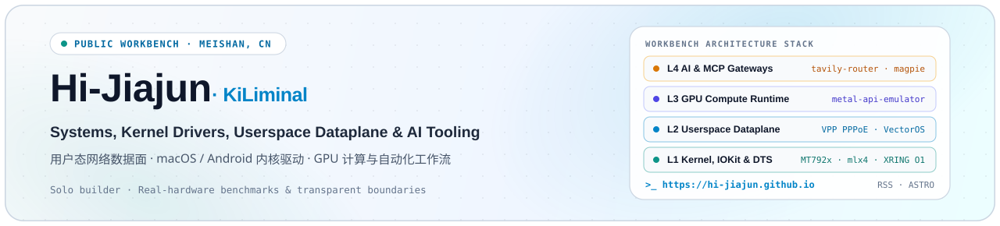

<picture>
  <source media="(prefers-color-scheme: dark)" srcset="./assets/profile-banner.svg" />
  
</picture>

{{ QUICK_LINKS }}

  {{ HEADER_INTRO_ZH }} 
  {{ HEADER_INTRO_EN }}

## 🔭 代表项目 Featured Workbench

{{ ORIGINAL_CARDS }}

{{ MORE_PROJECTS }}

## 📊 研发遥测 Telemetry

{{ STATS_SECTION }}

## ✍️ 最新文章 Latest Writing

{{ BLOG_POSTS }}

## 🧰 技术与支持 Stack &amp; Sponsor

{{ TOOLBOX_BADGES }}

<b>☕ 请我喝杯咖啡 · Buy me a coffee (WeChat / Alipay)</b>

 

{{ SPONSOR_CARDS }}

---

  {{ FOOTER_ZH }} 
  {{ FOOTER_EN }}

